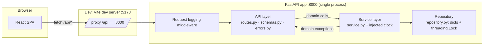
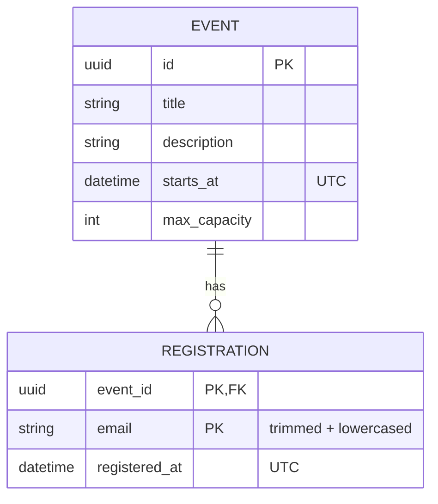

# Architecture

## Context and goals

An event management app: organizers create and edit events, and users register for them by email. The goal is a small,
explainable system where every business rule lives in one place and is covered by fast, deterministic tests.

## Requirements

**Functional**
- Events: create, list, get, update (title, description, start date/time, max capacity). No deletion.
- Registrations: register an email, cancel a registration, list an event's registrations.
- Rules: no registration for started events; never exceed capacity; no duplicate registration per email.

**Non-functional**
- In-memory storage only; no database, auth, or cloud dependencies.
- Correct capacity enforcement under concurrent requests within one process.
- Deterministic tests (injected clock), CI quality gates, ≥ 80% backend coverage.

## Components



## Data model



There is no User entity: a user is identified by normalized email. Registered count, remaining seats, `is_past`
and `is_full` are computed on read and never stored.

## Layer responsibilities

| Layer | Module | Responsibility |
|---|---|---|
| App wiring | `app/main.py` | `create_app()` builds the app with a service (tests inject their own), registers routes, handlers and logging middleware |
| API | `app/api/routes.py` | HTTP endpoints: parse input, call the service, shape responses |
| API | `app/api/schemas.py` | Request/response Pydantic models, separate from domain models |
| API | `app/api/errors.py` | Maps domain exceptions to status codes and a uniform error body |
| Service | `app/service.py` | All business rules, email normalization, time checks via the injected clock |
| Domain | `app/domain/models.py`, `errors.py` | Immutable dataclasses and domain exceptions; no HTTP knowledge |
| Repository | `app/repository.py` | `EventRepository` protocol and the in-memory implementation that owns the lock |

The service never raises HTTP errors; routes contain no business rules.

## Validation and rule enforcement

Validation is split by what it needs:

- **Request shape (Pydantic, API layer):** required fields, types, string lengths, `1 <= max_capacity <= 100000` as a
  strict integer, timezone-aware datetimes, valid email syntax, no unknown fields. Fails with 422 before the service runs.
- **Rules that depend on time or state (service):** start time in the future, event not started, seats left, no
  duplicate, capacity not below registrations. Time-based checks use the injected clock, so they cannot live in
  Pydantic validators.

The order in which rules are checked is part of the contract; see [API_SPEC.md](API_SPEC.md#rule-evaluation-order).

## In-memory design

```python
events: dict[UUID, Event]
registrations: dict[UUID, dict[str, Registration]]   # event_id → normalized email → registration
```

The nested dict gives O(1) duplicate checks, `len()` as the registered count (so it cannot drift), and insertion order
as registration order. Events are never deleted, so registrations are never orphaned. Data is lost on restart.

## Concurrency strategy

FastAPI runs the sync route handlers in a thread pool, so requests really run concurrently. Each service operation
runs inside `with repository.atomic():`, which holds one `threading.Lock` owned by the repository. This makes the
check-then-insert for registration atomic and also serializes it against capacity updates. The rules stay in the
service; only the lock lives in the repository.

One coarse lock is deliberate: operations are microseconds long, and per-event locks would add complexity without a
measurable benefit at this scale.

**Limitation:** the lock and the data are process-local. Running several Uvicorn workers or instances gives each one its
own separate data and no cross-process consistency. Run a single worker.

## Error handling and status code policy

| Status | Meaning |
|---|---|
| 422 | The request itself is invalid: shape, types, field rules, or a start time that is not in the future |
| 404 | The event or registration does not exist |
| 409 | The request is valid but conflicts with current state: full, duplicate, started event, capacity below registrations |
| 500 | Unexpected error; logged with a stack trace, generic message returned |

All errors share one body, `{code, message, details}`, produced by the handlers in `app/api/errors.py`.
Full list: [API_SPEC.md](API_SPEC.md#error-body).

## Logging

Standard library `logging`, no extra dependency:

- One INFO line per request from the middleware: method, path, status, duration. Uvicorn's own access log is turned off to avoid duplicate lines.
- INFO in the service for business events (event created/updated, registration created/cancelled). These log IDs, not emails.
- WARNING for every rule rejection, written once in the domain-error handler rather than at each raise site.
- Unhandled errors are logged with a stack trace.

The request line for `DELETE …/registrations/{email}` contains the email (see the privacy note in the API spec).

## Dev and production networking

The frontend only calls relative paths under `/api`, so it never needs to know the backend's address.

- **Development:** the Vite dev server proxies `/api` to `http://localhost:8000`. Browser and API look same-origin, so the backend configures **no CORS**.
- **Production (not built):** a reverse proxy or gateway (e.g. Nginx, CloudFront) serves the built frontend and routes `/api/*` to the backend under the same origin. CORS stays unnecessary.

## Assumptions

- An event is "past" (started) when `starts_at <= now`; there is no end time.
- Started events are read-only: they can't be updated and registrations can't be added or cancelled.
- Emails are compared trimmed and lowercased, including the local part.
- `PUT` replaces all editable fields; registrations survive a date change.
- Authentication and authorization are out of scope: anyone can edit any event and cancel any registration.

## Limitations

- Data is lost on restart; single process only (see Concurrency).
- No auth: cancellation only requires knowing the email.
- Emails in DELETE URLs appear in logs.
- No pagination; lists return everything.

## Production evolution (not implemented)

These are the natural next steps, listed so the current boundaries are clear:

1. Replace `InMemoryRepository` with a database implementation of `EventRepository`. Enforce capacity with a transaction (`SELECT … FOR UPDATE` or a conditional insert) and duplicates with a unique `(event_id, email)` constraint.
2. Add authentication: organizers own events, and users can cancel only their own registration.
3. Identify registrations by a server-issued ID in cancel URLs so emails stay out of logs.
4. Add pagination and filtering (upcoming/past) once event counts grow.
5. Deploy behind a reverse proxy with structured (JSON) logs and health checks.
