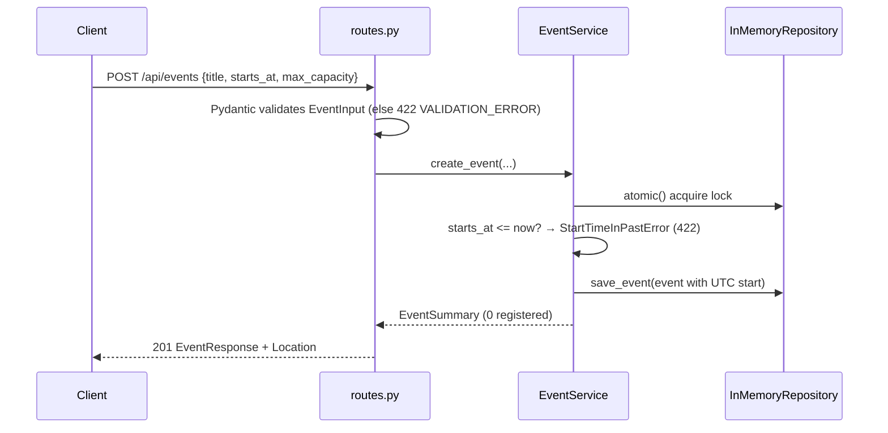
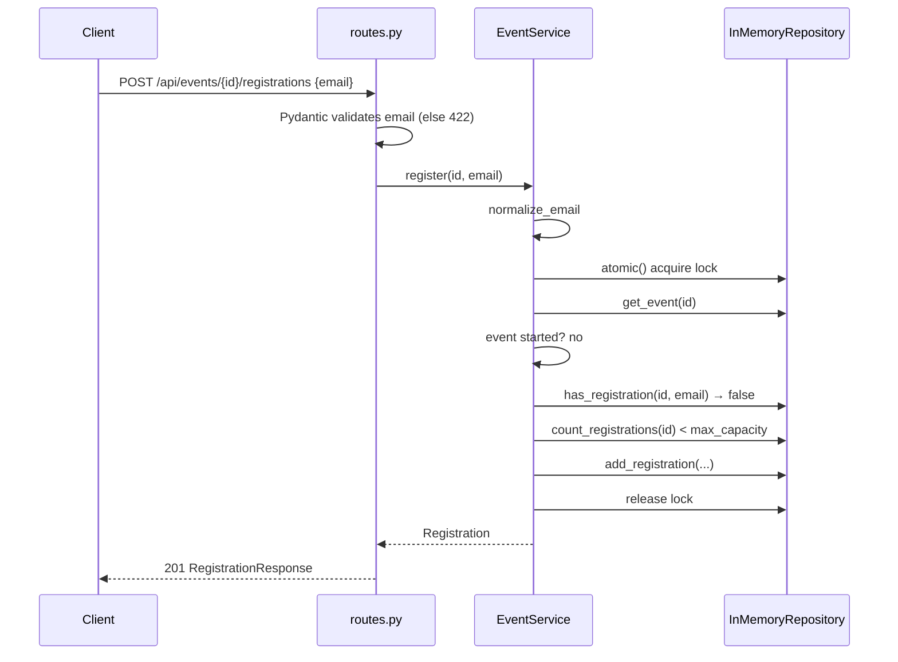
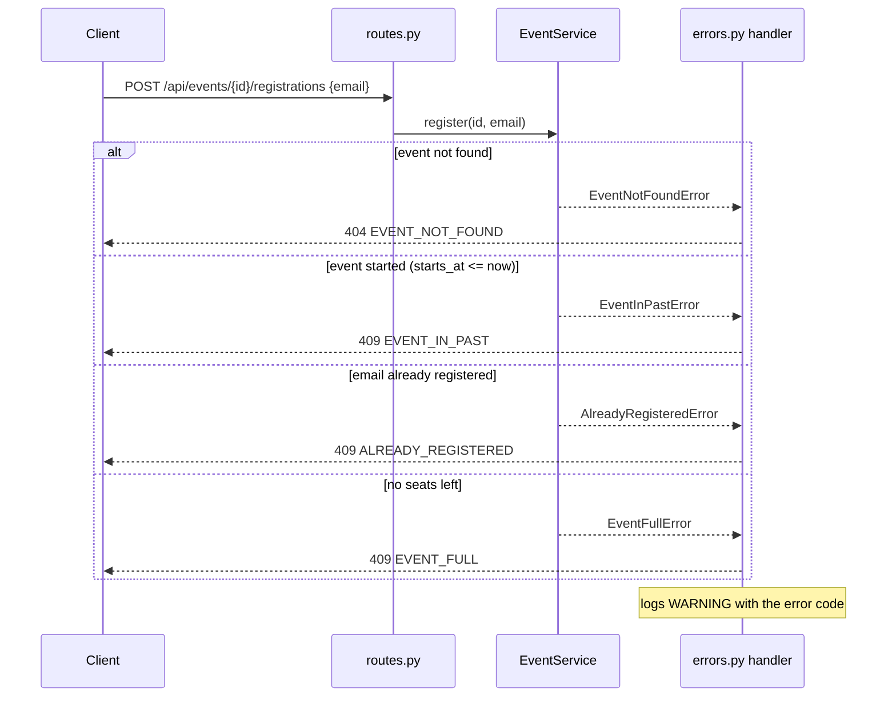
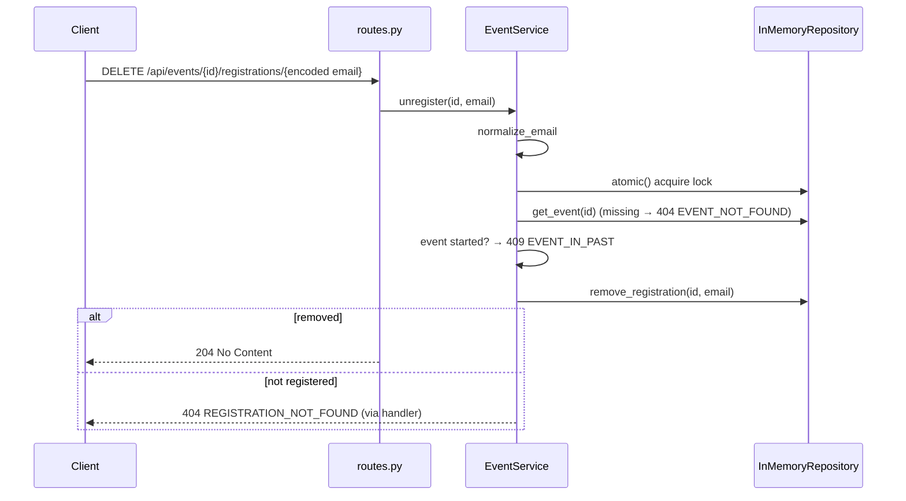
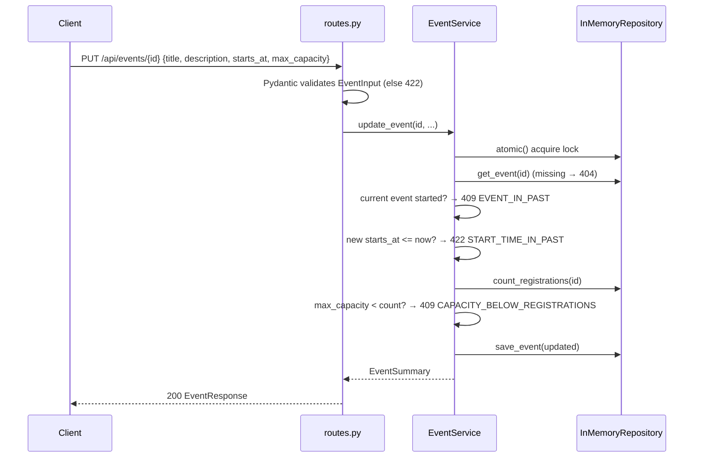
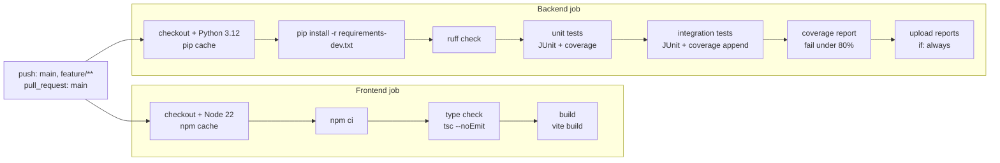

# Decisions

Short architecture decision records, followed by sequence diagrams, the CI pipeline, and the test strategy.

## ADR-1: FastAPI + React

- **Context:** a small REST API plus a browser UI, built and explained quickly.
- **Decision:** FastAPI with Pydantic for the backend; React + TypeScript (strict) + Vite for the frontend, using the native Fetch API.
- **Alternatives:** Flask (no built-in validation or OpenAPI); Django REST Framework (heavier, ORM-centric); Next.js (server rendering not needed).
- **Tradeoffs:** FastAPI gives validation, OpenAPI and Swagger UI for free, with less control over the error format, which we fix with custom handlers. React adds a build step but is widely known.
- **Consequences:** the OpenAPI document is the API source of truth. Request validation lives in schema declarations, not hand-written code. With only four screens, the frontend uses a ~30-line hash router instead of `react-router-dom`, and per-page `useState` instead of a state library.

## ADR-2: Layered architecture

- **Context:** business rules must be testable without HTTP and easy to locate.
- **Decision:** routes → service → repository, with domain models and exceptions separate from API schemas. The service raises domain exceptions; one handler maps them to HTTP.
- **Alternatives:** rules inside route handlers (fewer files, but rules get mixed with HTTP and need TestClient to test); hexagonal/ports-and-adapters with a full abstraction set (too much ceremony for this size).
- **Tradeoffs:** a few more modules and a mapping step between domain and response models.
- **Consequences:** unit tests call `EventService` directly; the status code policy lives in one table (`app/api/errors.py`).

## ADR-3: In-memory repository behind a small protocol

- **Context:** no database is allowed; storage must still be replaceable later.
- **Decision:** `InMemoryRepository` using dictionaries, typed against an `EventRepository` protocol. A fresh instance is created per app (and per test).
- **Alternatives:** module-level global dicts (shared state between tests); SQLite in-memory (a database in all but name, against the brief).
- **Tradeoffs:** data is lost on restart and cannot be shared across processes.
- **Consequences:** a database implementation can replace it without touching the service.

## ADR-4: Concurrency and capacity enforcement

- **Context:** sync FastAPI handlers run in a thread pool, so two registrations for the last seat can interleave between the capacity check and the insert.
- **Decision:** the repository owns one `threading.Lock`, exposed as `atomic()`. Every service operation runs inside it, so check-and-insert is atomic and capacity updates are serialized with registrations.
- **Alternatives:** per-event locks (finer-grained but more code and lock-lifecycle questions); async handlers on one event loop (correct only while no `await` sits between check and insert, which is fragile); optimistic retry (not needed without a database).
- **Tradeoffs:** all writes are serialized. That is negligible for in-memory operations.
- **Consequences:** correct within one process only. Multiple workers need a shared store with transactional guarantees (see [ARCHITECTURE.md](ARCHITECTURE.md#production-evolution-not-implemented)).

## ADR-5: GitHub Actions CI

- **Context:** quality gates must run on every change without secrets or cloud resources.
- **Decision:** one workflow with parallel backend and frontend jobs, triggered by pushes to `main` and `feature/**` and by pull requests to `main`. The backend runs Ruff, then unit and integration tests as separate steps with JUnit output, then a coverage gate at 80%. Reports are uploaded with `if: always()`. The frontend runs `npm ci`, `tsc --noEmit` and `vite build` on the Node version in `frontend/.nvmrc` (22). Actions are pinned to current major versions (v7, Node 24 runtime).
- **Alternatives:** a single combined test step (simpler, but the two suites aren't reported separately); a third-party coverage service (needs tokens).
- **Tradeoffs:** a feature branch with an open PR runs twice (push + PR events).
- **Consequences:** the workflow only reports status; a ruleset on `main` enforces it. It requires a pull request and both jobs as status checks on a branch up to date with `main`, and blocks direct and force pushes. Approvals are 0 (single contributor) and, as configured by the owner, nobody can bypass it.

## ADR-6: Email as identity and status code policy

- **Context:** no authentication or User entity is in scope, but duplicates must be detected reliably.
- **Decision:** a user is their email, trimmed and lowercased in the service before any comparison or storage. Status codes: 422 for an invalid request (including a start time not in the future), 404 for a missing event or registration, 409 for a valid request that conflicts with current state.
- **Alternatives:** a User entity with IDs (no auth to tie it to); case-sensitive local parts per RFC 5321 (technically correct, but in practice providers treat them case-insensitively and users expect that); 400 for all business errors (loses the shape-vs-state distinction).
- **Tradeoffs:** anyone who knows an email can cancel that registration. The email appears in DELETE URLs and therefore in logs.
- **Consequences:** clients can branch on the `code` field. The future fix for privacy is a registration ID in the URL.

## ADR-7: Event deletion is not implemented

- **Context:** the requirements list create, read and update for events, but also mention standard CRUD endpoints, so deletion is ambiguous.
- **Decision:** no `DELETE /api/events/{id}`; scope is kept to the explicitly listed operations. This is a scope decision, not a technical limitation: an unauthenticated delete that removes the event and cascades its registrations would be simple.
- **Alternatives:** a cascading hard delete; cancelling via an event status instead of deleting.
- **Tradeoffs:** the standard CRUD expectation is only partly met, and a reviewer may expect `DELETE`. In a real system, deleting an event with attendees raises business questions: notifying attendees, auditability, and whether a `CANCELLED` status is better than hard deletion.
- **Consequences:** if requested, a cascading `DELETE` is a small change (service, repository, tests). The fuller direction is an event status (`SCHEDULED`, `CANCELLED`, `COMPLETED`) with a cancellation flow, authorization and notifications.

## Sequence diagrams

### Create event

### Successful registration

### Registration rejection paths

### Unregistration

### Update event

## CI pipeline

The two jobs run in parallel and any failing step fails its job. The integration and coverage steps run even when unit tests fail, so both suites are always reported.

## Test strategy

- **Unit tests** (`backend/tests/unit`) call `EventService` directly with a fresh `InMemoryRepository` and a `FakeClock` fixed at `2026-01-01T12:00Z`. Tests move time with `clock.advance(...)`, so nothing depends on the real clock or on sleeping.
- **Integration tests** (`backend/tests/integration`) use `TestClient(create_app(service))` to check status codes, response schemas and the error body.
- **Isolation:** every test gets new repository, clock, service and app instances from fixtures. There is no module-level state, so test order doesn't matter.
- **Mutation check:** each core rule was broken on purpose (capacity `>=` → `>`, normalization removed, lock removed, `<=` → `<` on the start-time check, capacity-reduction check skipped, duplicate check removed). Every mutation turned at least one test red, and the code was then restored.

### Test matrix

| # | Rule | Unit tests | Integration tests |
|---|---|---|---|
| 1 | No registration for started events | `test_cannot_register_for_event_that_has_started`, `test_cannot_register_when_start_time_equals_now` | `test_registration_for_past_event_returns_409` |
| 2 | Capacity limit | `test_cannot_register_when_event_is_full`, `test_last_seat_can_be_taken` | `test_full_event_returns_409` |
| 3 | No duplicates (case/whitespace-insensitive) | `test_same_email_cannot_register_twice`, `test_duplicate_detected_regardless_of_case_and_whitespace`, `test_same_email_may_register_for_different_events`, `test_email_is_stored_trimmed_and_lowercase` | `test_duplicate_registration_returns_409`, `test_register_returns_201_with_normalized_email` |
| 4 | Cancel registration | `test_registered_user_can_unregister`, `test_unregister_matches_email_regardless_of_case_and_whitespace` | `test_unregister_with_percent_encoded_email_returns_204`, `test_unregister_accepts_unencoded_plus_and_at` |
| 5 | Seat restored, re-registration allowed | `test_cancellation_frees_a_seat_for_another_user`, `test_user_can_reregister_after_cancelling` | – |
| 6 | Unknown event → 404 | `test_cannot_register_for_unknown_event`, `test_getting_unknown_event_is_not_found`, `test_updating_unknown_event_is_not_found`, `test_cancelling_for_unknown_event_is_not_found`, `test_listing_registrations_of_unknown_event_is_not_found` | `test_registration_for_unknown_event_returns_404`, `test_unknown_event_returns_404_error_body` |
| 7 | Capacity is an integer in 1–100000 | – (schema rule) | `test_invalid_event_fields_are_rejected_with_field_details`, `test_max_capacity_upper_bound_is_accepted` |
| 8 | Required fields; aware, future dates | `test_cannot_create_event_in_the_past`, `test_cannot_create_event_starting_exactly_now`, `test_cannot_move_event_into_the_past`, `test_event_start_time_is_stored_in_utc` | `test_missing_required_fields_are_listed`, `test_invalid_event_fields_are_rejected_with_field_details`, `test_start_time_must_be_an_iso_string_not_a_unix_timestamp`, `test_malformed_body_is_reported_against_the_body_field`, `test_event_in_the_past_is_rejected_with_422` |
| 9 | Capacity not below registrations | `test_cannot_reduce_capacity_below_registrations`, `test_capacity_can_be_reduced_to_exactly_current_registrations` | `test_reducing_capacity_below_registrations_returns_409` |
| 10 | Cancel unknown registration → 404 | `test_cancelling_unregistered_email_is_not_found` | `test_unregister_unknown_email_returns_404` |
| 11 | Concurrency never exceeds capacity | `test_concurrent_registrations_never_exceed_capacity` | – |
| 12 | Started events frozen | `test_cannot_update_past_event`, `test_cannot_cancel_registration_for_past_event`, `test_event_becomes_past_once_its_start_time_is_reached`, `test_attendees_of_started_event_can_still_be_listed` | `test_updating_past_event_returns_409`, `test_unregister_for_past_event_returns_409` |
| 13 | Boundaries (exactly full, start = now, capacity = count) | `test_last_seat_can_be_taken`, `test_cannot_register_when_start_time_equals_now`, `test_cannot_create_event_starting_exactly_now`, `test_capacity_can_be_reduced_to_exactly_current_registrations` | `test_max_capacity_upper_bound_is_accepted` |
| – | Rule evaluation order | `test_duplicate_is_reported_before_full_when_both_apply`, `test_past_event_is_reported_before_missing_registration_on_cancel`, `test_past_event_rejection_takes_precedence_over_invalid_new_date`, `test_past_new_date_is_reported_before_capacity_conflict` | – |

### Concurrency test design

50 threads wait on a `threading.Barrier` and then register for an event with 10 seats. The test asserts exactly 10 successes.
The test repository sleeps 1 ms after reading the count. Without that pause the GIL makes the race too rare for the
test to prove anything. With it, removing the lock reliably fails the test, which was confirmed by the mutation check.

### Coverage

- Threshold: 80% line + branch on `backend/app`, enforced in CI by `coverage report --fail-under=80`. Current: 99%.
- Exclusion: the `EventRepository` protocol body (type declarations, never executed).
- Not covered: the real `utc_now` clock, which tests replace by design.

### Frontend verification

The frontend has no committed automated tests (optional in scope). CI enforces strict type checking and a production
build. During development, the UI was exercised in a headless browser against the real backend through the Vite
proxy, with no mocks. The run covered: empty dashboard, client validation, create (local time arrives as the matching
UTC), register, double-click sending one request, duplicate and full errors from the API, unregister, edit with a 409
caused by a change after the form loaded, not-found IDs, a past event with all actions disabled, and no horizontal
scroll at 375px width.

### Known limitations

- The concurrency test proves the invariant only within one process and with the thread pool. It says nothing about multiple workers, which are unsupported.
- The 500 handler is tested with a stub service, not a real failure mode.
